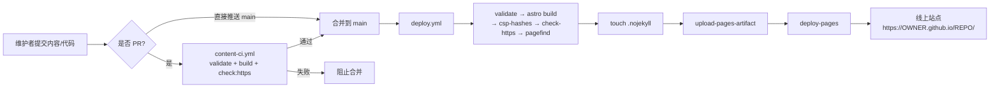

# 1024Soft 部署文档

> 适用版本：v1.0　|　文档版本：1.0　|　更新日期：2026-11-16
> 本文描述将本项目部署到 **GitHub Pages** 的标准化流程。所有配置项、脚本名与流水线均取自当前代码库，可直接对照执行。

---

## 目录

1. [概述](#1-概述)
2. [部署架构与自动化流程](#2-部署架构与自动化流程)
3. [前置条件](#3-前置条件)
4. [首次部署（标准流程）](#4-首次部署标准流程)
5. [环境变量参考](#5-环境变量参考)
6. [构建流程详解](#6-构建流程详解)
7. [全站 HTTPS 说明](#7-全站-https-说明)
8. [自定义域名（可选）](#8-自定义域名可选)
9. [日常内容发布流程](#9-日常内容发布流程)
10. [验收清单](#10-验收清单)
11. [回滚与重新部署](#11-回滚与重新部署)
12. [常见故障排查](#12-常见故障排查)
13. [安全说明](#13-安全说明)
14. [附录：关键文件清单](#14-附录关键文件清单)

---

## 1. 概述

1024Soft 是一个 **零服务器、零数据库、零成本** 的静态站点：前台、评论区与管理后台全部托管在 GitHub Pages。构建期的校验与发布由 GitHub Actions 承担，内容（软件条目）以 Markdown 形式存放在仓库中，"Git 即数据库"。

### 部署方式一览

| 项目 | 说明 |
| --- | --- |
| 托管平台 | GitHub Pages，Source 必须选择 **GitHub Actions** |
| 站点类型 | Astro 5 静态导出（SSG），`output: 'static'`、`trailingSlash: 'always'` |
| 构建环境 | `ubuntu-latest`，Node.js **22**，使用 `npm ci` + `package-lock.json` |
| 发布动作 | `actions/upload-pages-artifact@v3` → `actions/deploy-pages@v4` |
| 内容校验 | 每个 PR 触发 `content-ci.yml`，推送 `main` 触发 `deploy.yml` |
| 协议 | 全站强制 HTTPS，构建期守卫 + Pages 端 Enforce HTTPS 双重保证 |
| 搜索 | Pagefind 客户端索引（随产物上传，依赖 `.nojekyll` + 隐藏文件上传） |
| 评论 | 生产用 Giscus（GitHub Discussions），后台可直接管理真实评论；未配置 ID 时自动降级为本地演示模式 |

> **重要**：本站点是纯静态产物，TLS 由 GitHub 在边缘节点终止。产物本身无法发送 HSTS 响应头，因此必须在仓库设置中开启 **Enforce HTTPS**（见第 4 节）。

---

## 2. 部署架构与自动化流程

### 2.1 两条流水线

| 工作流文件 | 触发条件 | 权限 | 作用 |
| --- | --- | --- | --- |
| `.github/workflows/content-ci.yml` | 针对 `content/`、`data/`、`src/`、`public/`、`scripts/`、`package.json`、`package-lock.json`、`astro.config.mjs` 的 **Pull Request**，及手动触发 | `contents: read`、`pull-requests: write` | PR 关卡：内容校验 + 完整构建 + HTTPS 检查，任一失败阻止合并 |
| `.github/workflows/deploy.yml` | 推送 `main`（路径同上，另含 `deploy.yml` 自身），及手动触发 | `contents: read`、`pages: write`、`id-token: write` | 构建并发布到 GitHub Pages |

两条流水线均设置了 `concurrency.group: pages` 且 `cancel-in-progress: false`，保证发布任务串行、不会被中途取消。

### 2.2 发布流程图



### 2.3 一次 `npm run build` 的五步（不可颠倒）

1. `npm run validate` —— 跨文件内容校验（见 6.1）。
2. `astro build` —— 静态生成，产出 `dist/`。
3. `node scripts/csp-hashes.mjs` —— 为 Astro 内联脚本计算 SHA-256 并写回 CSP，避免放开 `unsafe-inline`。
4. `node scripts/check-https.mjs` —— 全站 HTTPS 守卫，扫描产物（见第 7 节）。
5. `npm run search:index` —— Pagefind 生成客户端搜索索引到 `dist/_pagefind/`。

---

## 3. 前置条件

- 一个 GitHub 账号，且拥有可创建仓库的权限。
- 本地安装 **Node.js 22**（项目 `package.json` 声明 `@astrojs/*` 需 Node ≥ 20，CI 固定 22）。
- 本地安装 npm（CI 使用 npm；请勿在 CI 改用 pnpm，否则与 `package-lock.json` 不一致）。
- 如需生产评论区：一个 GitHub 仓库 + 启用 Discussions + Giscus App（可后置，先上线再配）。
- 如需后台写入能力：维护者的 fine-grained PAT（见 9.2）。

---

## 4. 首次部署（标准流程）

### Step 1 — 本地自检

在推送之前，先在本地完整跑一遍构建链，确认无内容错误：

```bash
npm install
npm run validate     # 内容校验，应为 0 错误
npm run build        # 完整构建 + HTTPS 守卫 + Pagefind 索引
```

成功后应看到：`dist/index.html` 存在、`dist/_pagefind/` 生成、`HTTPS 守卫通过`、`生成 96 个页面`（页面数随内容增减）。

> 本地可用 `npm run serve` 以自签证书在 `https://127.0.0.1:4321/` 预览，协议行为与线上一致（详见 README 第 2 节）。

### Step 2 — 创建仓库并推送

1. 在 GitHub 新建一个 **公开** 仓库（公开仓库才免费用 GitHub Pages），例如 `1024soft`。
2. 将项目目录内容推送到 `main` 分支：

```bash
git init
git remote add origin https://github.com/<OWNER>/<REPO>.git
git add . && git commit -m "init: 1024soft v1.0"
git branch -M main
git push -u origin main
```

> `dist/`、`node_modules/`、`.astro/`、`.env` 已在 `.gitignore` 中，**不要提交**；产物由 CI 现场生成。

### Step 3 — 配置 Pages

进入仓库 **Settings → Pages → Build and deployment**：

- **Source**：选择 **GitHub Actions**（**不要**选 "Deploy from a branch"，否则不走本项目的流水线）。
- 勾选 **Enforce HTTPS**。这是全站 HTTPS 的必要一步。

### Step 4 — 配置 Repository Variables

进入 **Settings → Secrets and variables → Actions → Variables → New repository variable**，添加下表变量。

> 全部是公开值，**不要创建任何 Secret**。任何密钥都不得加 `PUBLIC_` 前缀。

| Variable | 示例值（项目站点 / 仓库名 `1024soft`） | 是否必填 | 说明 |
| --- | --- | --- | --- |
| `PUBLIC_SITE_URL` | `https://yourname.github.io` | 建议填 | 站点根 URL，**必须 `https://`**；自定义域名填 `https://soft.example.com` |
| `PUBLIC_BASE_PATH` | `/1024soft` | 建议填 | 必须与仓库名一致；用户站点 / 自定义域名填 `/` |
| `PUBLIC_REPO_OWNER` | `yourname` | 可选 | 后台 API / 页脚用；未填由 `github.repository_owner` 兜底 |
| `PUBLIC_REPO_NAME` | `1024soft` | 可选 | 后台 API 用；未填由仓库名兜底 |
| `PUBLIC_REPO_URL` | `https://github.com/yourname/1024soft` | 可选 | 页脚 / 投稿 / 编辑链接；未填自动拼接 |
| `PUBLIC_GISCUS_REPO` | `yourname/1024soft` | 评论用 | Giscus 仓库 |
| `PUBLIC_GISCUS_REPO_ID` | `R_kgDO...` | 评论用 | 从 giscus.app 获取，形如 `R_` 开头 |
| `PUBLIC_GISCUS_CATEGORY` | `Comments` | 评论用 | Discussions 分类名 |
| `PUBLIC_GISCUS_CATEGORY_ID` | `DIC_kwDO...` | 评论用 | 从 giscus.app 获取，`DIC_` 开头 |
| `PUBLIC_GISCUS_MAPPING` | `pathname` | 建议固定 | **固定用 `pathname`**，换域名不丢评论 |
| `PUBLIC_GISCUS_LANG` | `zh-CN` | 可选 | 界面语言 |

**兜底逻辑**（来自 `deploy.yml`）：`PUBLIC_SITE_URL` 缺省为 `https://<owner>.github.io`，`PUBLIC_BASE_PATH` 缺省为 `/<repo>`，`PUBLIC_REPO_OWNER/NAME/URL` 均由 GitHub 上下文自动推导。也就是说，最小配置下只设置 `PUBLIC_SITE_URL` 与 `PUBLIC_BASE_PATH` 即可上线；Giscus 相关留空时评论区自动降级为本地演示模式。

### Step 5 — Actions 权限（已内置，通常无需改动）

`deploy.yml` 已在文件头声明所需权限，`actions/deploy-pages@v4` 依赖 `pages: write` 与 `id-token: write`：

```yaml
permissions:
  contents: read
  pages: write
  id-token: write
```

若仓库由 Organization 统一管理且禁用了 workflow 令牌写入权限，需在 **Settings → Actions → General → Workflow permissions** 设为 "Read and write permissions"，并确保 Pages 的 Source 为 GitHub Actions。

### Step 6 — 开启 Discussions 并安装 Giscus（生产评论，可选）

1. **Settings → General → Features** 勾选 **Discussions**。
2. 新建分类 `Comments`（普通讨论类型即可）。
3. 访问 <https://giscus.app/>，按向导安装 GitHub App 并仅授权本仓库；复制生成的 `data-repo-id`、`data-category-id` 填入 Step 4 对应变量。

> 暂不配置也能上线：评论区会进入本地演示模式（数据仅存访问者浏览器）。

### Step 7 — 分支保护与代码归属（推荐）

1. **Settings → Branches → Add rule**，选择 `main`：
   - 勾选 "Require a pull request before merging"，至少 1 个审批；
   - 勾选 "Require status checks to pass"，选中 `Content CI` 的校验任务；
   - 勾选 "Do not allow bypassing the above settings"。
2. 编辑 `.github/CODEOWNERS`，把 `@OWNER` 换成你的 GitHub 用户名。

### Step 8 — 触发首次部署并验收

推送后进入 **Actions** 页，应看到两个工作流：

- `Content CI`（若有 PR）→ 校验内容；
- `Deploy to GitHub Pages` → 构建并发布。

全部绿勾后，访问 `https://<OWNER>.github.io/<REPO>/` 验证（详见第 10 节验收清单）。

---

## 5. 环境变量参考

### 5.1 本地 `.env`（可选）

复制 `.env.example` 为 `.env`。本地默认走演示模式，不配置也能运行。示例关键项：

```dotenv
PUBLIC_SITE_URL=https://OWNER.github.io
PUBLIC_BASE_PATH=/REPO
PUBLIC_REPO_URL=https://github.com/OWNER/REPO
PUBLIC_REPO_OWNER=OWNER
PUBLIC_REPO_NAME=REPO
```

> `.env` 已在 `.gitignore` 中，不会入库。CI 使用 Repository Variables 注入同名变量，优先级高于 `astro.config.mjs` 的默认值。

### 5.2 变量如何生效

`astro.config.mjs` 中：

```js
const RAW_SITE = process.env.PUBLIC_SITE_URL || 'https://OWNER.github.io';
const SITE = RAW_SITE.replace(/^http:\/\//i, 'https://');  // 误配 http 自动升级
const BASE = process.env.PUBLIC_BASE_PATH || '/';
```

- `SITE` → Astro `site`，决定 canonical / og:url / sitemap / RSS 的绝对 URL。
- `BASE` → Astro `base`，决定所有站内链接前缀（项目站点必须与仓库名一致）。
- sitemap 集成会过滤 `/go/`（跳转确认页）与 `/admin/`（后台），二者不进索引。
- 任何 `PUBLIC_*_URL` 被误配为 `http://` 都会被自动升级，并由 `check-https.mjs` 在构建期硬性拦截。

---

## 6. 构建流程详解

### 6.1 内容校验 `scripts/validate-content.mjs`

在构建最前端执行，直接读取 `content/software/*.md` 与 `data/*.json`，校验：

- `slug` 唯一，且符合格式（小写字母、数字、连字符，2–60 位）；
- `categories` 必须有且仅 1 项，且存在于分类字典；
- `platforms` 至少 1 项，且存在于平台字典；
- `license_code`、`download_url` 域名需在 `data/allowed-download-hosts.json` 白名单内；
- 所有 URL 必须为 `https://`；
- 字段联动：`is_open_source: true` 时 `repo_url` 与 `license_code` 必填；为 `false` 时二者必须留空；
- 日期字段 `released_at`、`last_checked_at` 为 `YYYY-MM-DD` 文本格式。

校验失败会以非零码退出，阻断后续构建与合并。

### 6.2 产物结构

成功构建后 `dist/` 关键内容：

```
dist/
├── index.html                 # 首页
├── _astro/                    # JS / CSS 资源（含 CSP 哈希对应的内联脚本）
├── _pagefind/                 # Pagefind 搜索索引（隐藏目录，依赖 .nojekyll）
├── data/                      # software.json / search-index.json / health.json
├── rss.xml / sitemap-index.xml
├── .nojekyll                  # deploy.yml 现场 touch，阻止 Jekyll 忽略 _pagefind
└── ...（分类/平台/许可证/详情/跳转等页面）
```

`upload-pages-artifact@v3` 设置了 `include-hidden-files: true`，确保 `.nojekyll` 与 `_pagefind/` 被完整上传。

---

## 7. 全站 HTTPS 说明

静态站无法在服务端重定向或发送 HSTS，因此本项目采用"构建期守卫 + 平台配置"双层策略。

### 7.1 构建期守卫 `scripts/check-https.mjs`

`npm run build` 与 `content-ci.yml` 都会执行，检查三类问题，任一失败即阻断发布：

1. **配置层**：`PUBLIC_SITE_URL`、`PUBLIC_REPO_URL`、`PUBLIC_API_BASE` 及 `astro.config.mjs` 默认站点 URL 必须为 `https://`。
2. **产物层**：扫描 `dist/` 的 HTML / XML / CSS / JS / JSON 等，任何 `http://` 都拒绝（放行 4 类仅作标识符的命名空间 URI，如 W3C 命名空间、Octokit 内部 base，它们不发起网络请求）。
3. **正向断言**：`canonical`、`og:url`、sitemap `<loc>`、RSS `<link>` 必须是绝对 `https://` URL。

CI 中 `deploy.yml`、`content-ci.yml` 另有 shell 步骤再次确认 `PUBLIC_SITE_URL` 以 `https://` 开头。

### 7.2 浏览器层

前台与后台的 CSP 均包含 `upgrade-insecure-requests`，遗留的明文子资源会自动升级，杜绝混合内容。

### 7.3 平台层

在 **Settings → Pages** 勾选 **Enforce HTTPS**。GitHub 为 `*.github.io` 及自定义域名签发免费证书，TLS 由 GitHub 终止。

---

## 8. 自定义域名（可选）

1. 在仓库根目录创建 `public/CNAME`，内容为你的域名（如 `soft.example.com`）。
2. DNS 添加一条 `CNAME` 记录：`soft` → `<OWNER>.github.io`（根域用 `A` 记录指向 GitHub Pages 的 IP）。
3. 在 **Settings → Pages → Custom domain** 填入同一域名，等待 DNS 校验通过并勾选 **Enforce HTTPS**。
4. 修改 Repository Variables：
   - `PUBLIC_BASE_PATH` → `/`
   - `PUBLIC_SITE_URL` → `https://soft.example.com`
   - `PUBLIC_REPO_URL` 保持不变
5. 重新触发一次 `Deploy to GitHub Pages`。

> 换域名后，Giscus 使用 `pathname` 映射可保留原有评论（切勿改成 `url` 映射）。

---

## 9. 日常内容发布流程

### 9.1 三种发布入口

| 入口 | 适用场景 | 流程 |
| --- | --- | --- |
| Issue 投稿表单 | 外部贡献者推荐软件 | 提交 Issue → 维护者审核 → 生成 Markdown |
| 直接提 PR | 熟悉 Git 的贡献者 | Fork → 新增 `content/software/xxx.md` → PR → Content CI → 合并 |
| 管理后台 `/admin/` | 维护者日常增删改 | PAT 登录 → 保存 → 自动建分支/提交/PR → Content CI → 合并 |

无论哪种入口，最终都以 PR 形式合入 `main`，触发 Pages 自动发布，静态产物无状态、即刻生效。

### 9.2 管理后台写入所需 PAT

后台是静态 SPA，**任何人都能打开 `/admin/`，但只有持有效 PAT 且有 push 权限的维护者才能改动线上仓库**。

创建 fine-grained PAT（GitHub → Settings → Developer settings → Fine-grained personal access tokens）：

- **Repository access**：Only select repositories → 选本项目；
- **Permissions**：
  - `Contents: Read & Write`（必需，写内容）
  - `Issues: Read & Write`（投稿审核）
  - `Pull requests: Read & Write`（创建合并 PR）
  - `Metadata: Read-only`（自动包含）
  - `Discussions: Read & Write`（后台「评论管理」页读取并管理 Giscus 真实评论所必需；未授予时该页会提示权限不足）
- **有效期**：建议 ≤ 90 天。

后台会调用 `GET /user` 与 `GET /repos/{owner}/{repo}` 自检，无 `push` 权限直接拒绝。评论管理页另走 GitHub **GraphQL**（`repository.discussions` / `minimizeComment` / `deleteDiscussionComment`，端点同为 `https://api.github.com/graphql`，已被后台 CSP 放行），需要 PAT 具备 `Discussions: Read & Write`；未授予时仅评论管理页报错，内容/投稿流程不受影响。令牌仅存浏览器 `sessionStorage`，关闭标签页即失效，不会写入仓库、`.env`、CI、日志或 URL。

---

## 10. 验收清单

部署完成后逐项确认：

- [ ] 首页 `https://<OWNER>.github.io/<REPO>/` 返回 200，样式与图片正常。
- [ ] 地址栏为 HTTPS，浏览器无"混合内容"警告，Pages 已开启 Enforce HTTPS。
- [ ] 以下端点均返回 200：`/rss.xml`、`/sitemap-index.xml`、`/data/software.json`、`/data/search-index.json`、`/data/health.json`。
- [ ] 搜索可用（Pagefind 索引随产物上传，`_pagefind/` 未被 Jekyll 吞掉）。
- [ ] 分类 / 平台 / 许可证归档页、详情页、`/go/` 跳转确认页均正常。
- [ ] 评论区：已配置 Giscus 时可用 GitHub 登录；未配置时为本地演示模式。
- [ ] `/admin/` 可打开，演示模式可体验；维护者 PAT 登录自检通过。
- [ ] Actions 中 `Deploy to GitHub Pages` 全绿，Summary 显示页面数与 HTTPS 通过。
- [ ] 用 Lighthouse 检查首页与详情页的性能 / 可访问性 / SEO。
- [ ] 实测一次"投稿 → 审核 → 上线"闭环。

---

## 11. 回滚与重新部署

| 场景 | 操作 |
| --- | --- |
| 内容或代码出错 | `git revert <commit>` 并推送，Actions 自动重新构建发布；静态产物无状态，回滚即刻生效。 |
| 想重跑上一成功版本 | 进入 Actions → 找到最近一次成功的 `Deploy to GitHub Pages` run → Re-run all jobs。 |
| 配置变量改错 | 修正 Repository Variables 后，手动触发 `workflow_dispatch`（或推送一个空提交）重新部署。 |
| 产物异常（样式/搜索丢失） | 确认本地 `npm run build` 完整通过后重新推送；检查 `.nojekyll` 与 `include-hidden-files` 是否生效。 |

---

## 12. 常见故障排查

| 现象 | 可能原因 | 处理 |
| --- | --- | --- |
| 页面 404 / CSS 全丢 | `PUBLIC_BASE_PATH` 与仓库名不一致 | 设为 `/<仓库名>`（用户站点/自定义域名用 `/`），重新部署 |
| 搜索无结果 | Pagefind 索引未随产物上传 | 确认 `npm run build` 完整执行；`deploy.yml` 的 `include-hidden-files: true` 与 `.nojekyll` 生效 |
| 构建报"明文 HTTP"错误 | 某处写了 `http://` URL | 改为 `https://`；命名空间类 URI 已被守卫白名单放行 |
| 评论区一直是演示模式 | Giscus 的 `REPO_ID` / `CATEGORY_ID` 为空或格式不对 | ID 应分别以 `R_` / `DIC_` 开头，且仓库已启用 Discussions |
| 后台登录提示无权限 | PAT 非 fine-grained，或未授权到该仓库，或无 push 权限 | 按 9.2 重新签发最小权限 PAT |
| 后台评论管理页报"读取评论失败" | PAT 未授予 `Discussions: Read & Write`，或 GraphQL 被 CSP 拦截 | 给 PAT 加 `Discussions: Read & Write`（见 9.2）；后台 CSP 的 `connect-src` 须含 `https://api.github.com` |
| 后台按钮点击无反应 | CSP 拦截 / PAT 过期 | 后台脚本全部走外部 bundle；重新登录并确认令牌有效 |
| 部署 workflow 报 403 | Pages Source 非 GitHub Actions，或 workflow 权限不足 | Settings → Pages 选 GitHub Actions；Actions 权限设为读写 |
| 换域名后评论"消失" | 使用了 `url` 映射 | 固定 `pathname` 映射，不要改 |
| PR 的 Content CI 未触发 | 改动路径不在触发列表 | 确认改动落在 `content/`、`data/`、`src/`、`public/`、`scripts/` 等路径 |

---

## 13. 安全说明

- **无服务端密钥**：仓库与 CI 中不存在任何 Secret；后台不存 PAT。
- **令牌最小化**：后台 PAT 仅授权单仓库、最小权限、建议 ≤ 90 天过期。
- **双重权限校验**：前端 `canPush` 判断仅为体验层，GitHub API 会二次拒绝越权写入；PR 还须通过 Content CI 与人工审批。
- **下载安全**：所有下载链接经 `/go/<slug>/` 确认页展示目标域名，且域名必须在白名单内；本站不托管任何安装包。
- **CSP**：前台与后台采用 SHA-256 哈希白名单，不放开 `unsafe-inline`，并启用 `upgrade-insecure-requests`。

---

## 14. 附录：关键文件清单

| 文件 | 作用 |
| --- | --- |
| `.github/workflows/deploy.yml` | 推送 `main` → 构建 → 发布到 Pages |
| `.github/workflows/content-ci.yml` | PR 关卡：内容校验 + 构建 + HTTPS 检查 |
| `astro.config.mjs` | `site` / `base` / sitemap / HTTPS 升级 |
| `package.json` | 构建脚本链（validate / build / check:https / search:index） |
| `scripts/validate-content.mjs` | 内容校验（CI 关卡） |
| `scripts/csp-hashes.mjs` | 内联脚本 CSP SHA-256 |
| `scripts/check-https.mjs` | 全站 HTTPS 守卫（CI 关卡） |
| `scripts/serve-https.mjs` | 本地 HTTPS 预览服务 |
| `content/software/*.md` | 软件条目（一条一个文件） |
| `data/*.json` | 分类 / 平台 / 许可证 / 下载域名白名单 |
| `public/CNAME` | 自定义域名（可选，需自行创建） |
| `.env.example` | 环境变量示例（公开值） |
| `README.md` | 项目总览与快速上手 |
| `PRD.md` | 完整产品需求文档 |

---

> 本部署文档依据当前代码库真实配置编写。若后续修改了工作流、脚本或环境变量，请同步更新本文与 `README.md`，保持文档与实现一致。
